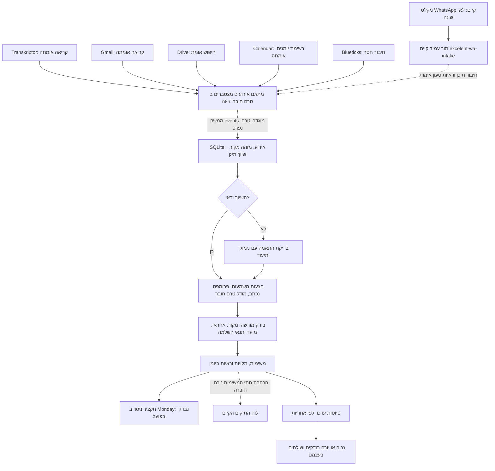

# מערכת תפעול אקסלנט, 27.10.2026

מצב המערכת המלאה: BLOCKED. נבנתה ונבדקה ליבת ניסיון; לא הופעלה מערכת עסקית רציפה בייצור. אין מנגנון שליחה במודול. הכתיבה החיצונית היחידה בסבב היא רשומת ראיות סינתטית בלוח Monday המבודד. אין בה לקוח אמיתי או מספר טלפון.

תוצר לבדיקה: [רשומת המסע ב־Monday](https://kho566440.monday.com/boards/5106494186/pulses/3313413683). אותה רשומה התעדכנה בשלוש גרסאות עם קריאה חוזרת מלאה אחרי כל כתיבה. זהו תקציר תיק ניסיון המכיל שתי משימות, ולא שתי משימות ייצור עם שיוך משתמשים. [קבלות האימות](../runtime/business-ops-monday-20261027.json).

בדיקות עדכניות: 27/27 בדיקות המודול עברו. `npm test` עבר עם 27 בדיקות תפעול, 366 בדיקות משפך, 59 בדיקות אתר ו־4 בדיקות nginx, בסך הכול 456. לאחר הקשחת מעטפת המקור הורצה סוויטת התפעול מחדש. ארבע בדיקות ביקורת בשני סקריפטים זיהו במפורש קוד מקולקל בזיכרון. המסע, גבולות האימות והחסמים מפורטים ב־[SOURCE_CHECKPOINTS.md](SOURCE_CHECKPOINTS.md); תוצאות ההרצות נשמרות ב־[status.json](status.json).

שמירת קבצים: PASS. בבדיקה הראשונית `git add` נחסם ביצירת `.git/index.lock`; הרשאות לא שונו. בהמשך מקור הליבה פורסם בענף באמצעות מחבר GitHub מאומת ב־`6d7114a`, ודוחות הקליטה ו־CAPI פורסמו ב־`ebbc81e`. השינויים המקומיים האחרים נשמרו. פירוט עדכני של הרחבת הקליטה נמצא ב־[SOURCE_CHECKPOINTS.md](SOURCE_CHECKPOINTS.md), ושל אימות Meta החסום ב־[דוח CAPI](../runtime/capi-test-events-20261027.json).

בבדיקה הראשונה nginx נחסם מקריאת תיקיית Temp של מערכת ההפעלה; הגדרת TEMP/TMP בתוך תיקיית הניסוי פתרה זאת. בהרצה נוספת נחשפה התנגשות קיימת בין בדיקות שמשנות ומעתיקות את `src/config/campaigns/_tmp_test.json`. קובצי בדיקות המשפך רצים כעת ברצף עם `--test-concurrency=1`; שום בדיקה לא הוסרה או הוחלשה.

## מה נבנה ומה עדיין חסר

| רכיב | סטטוס | ראיה וגבול האימות |
|---|---|---|
| יומן אירועים עמיד, שיוך מדויק, היסטוריה וגרסאות | PASS | `src/services/business-ops/store.js`, בדיקות SQLite כולל פתיחה מחדש. נתונים סינתטיים |
| התחייבויות, תלויות וראיות השלמה | PASS | `tests/business-ops/operations.test.js`; אמירת ״שלחתי״ אינה סוגרת משימה |
| אימות API לפי תפקידי קליטה, בדיקה וקריאה | PASS | `server.test.js`, HTTP אמיתי ב־loopback. אין עדיין הרשאות לפי תיק או SSO |
| קריאה וכתיבה ל־Monday | PASS | מחבר חי, לוח ניסוי בלבד, 3/3 גרסאות. ההעברה בין הליבה למחבר נעשתה בסבב באופן מתוזמר על ידי הסוכן, ולא מעובד רציף פרוס |
| טיוטות, בחירת ערוץ וסיכומים ללא חזרה | PASS | `response.test.js`, סיכום פנימי לוגי. זיהוי נמענים ומסירה בפועל לא נבדקו |
| רכיב n8n לייבוא | PASS | `build-workflow.js`, בדיקת גרף ושער קבלה. Build בלבד, לא יובא או הורץ בשרת |
| הבנת שפה טבעית אוטומטית | BLOCKED | נכתב פרומפט חילוץ, אך לא חובר מודל לעובד. בדיקות המסע משתמשות בתצפיות מובנות שנבדקו מראש |
| קליטה רציפה מכל המקורות | BLOCKED | נדרש חיבור מקור מאומת ונקודת שירות פרטית נגישה מ־n8n; Blueticks חסר בחיבור הנוכחי |
| שיוך נריה ויורם ל־People ב־Monday | BLOCKED | חיפוש ״נריה״ לא החזיר משתמש. החשבון המשותף אינו הוכחת זהות אישית |
| ניהול משימות ייצור בלוח הקיים | BLOCKED | נדרש מיפוי שדות מלא של תתי המשימות, בדיקת תופעות לוואי והרשאות; המודול מסרב לכתוב ללוחות ייצור |
| משלוחים אוטומטיים | BLOCKED | אין סמכות שליחה. WhatsApp נשאר קריאה וטיוטות בלבד, גם אחרי חיבור המקורות |

## מפת המצב שנקרא בפועל

| מערכת | קריאה | כתיבה | קבלת אירועים | שליחה |
|---|---|---|---|---|
| Monday | PASS: מבנה 3 לוחות, תיקים, תתי משימות ואוטומציות | PASS: רשומת ניסוי בלבד | NOT TESTED | BLOCKED: לא נשלחו התראות מהמודול |
| Transkriptor | PASS: 42 כותרות עם ״נריה״, 2 תמלולים מלאים | BLOCKED: קריאה בלבד | NOT TESTED | BLOCKED |
| Gmail | PASS: פרופיל וחיפוש הודעות | NOT TESTED | NOT TESTED | BLOCKED: ללא סמכות הפעלה |
| Google Drive | PASS: חיפוש מטא־נתונים של מקורות | NOT TESTED | NOT TESTED | BLOCKED |
| Google Calendar | PASS: רשימת 8 יומנים ותפקידי גישה מדווחים | NOT TESTED | NOT TESTED | BLOCKED: אין זימונים |
| n8n | PASS: רשימת 84 תהליכים, 2 עמודים ומבנה עובד ה־WA | NOT TESTED בסבב זה | NOT TESTED עבור הליבה החדשה | BLOCKED |
| Blueticks | BLOCKED: אין חיבור קריאה מאומת בסבב | BLOCKED: מדיניות | NOT TESTED | BLOCKED: מדיניות |
| Gambot | NOT TESTED בסבב | BLOCKED: מדיניות | NOT TESTED מחדש; נמצא מסלול קיים ב־n8n | BLOCKED: מדיניות |

אלה תוצאות של הסשן הנוכחי, לא הבטחה שמחברי ChatGPT זמינים בתהליך CLI עתידי. בדיקת כתיבה או משלוח אינה מוסקת מהתקנת כלי או מהתפקיד `owner` ביומן.

Gmail החזיר `yoram@kho.org.il`; היומן הראשי החזיר `office@kho.org.il`. הפער אינו טעות מוכחת, אבל מחייב בחירת חשבון מקור מפורשת לפני קליטה רציפה. אין להסיק מהם כתובת לשליחת סיכומים לנריה.

ב־n8n יש Credential בשם Gmail account, אך עצם הופעתו אינה מאמתת את התיבה, ההרשאות או קבלת האירועים. השרת הפעיל שנקרא הוא `n8n-qhxa.srv1604140.hstgr.cloud`; נמצא גם מייל הזמנה לשירות ענן אחר, ולא הונח שהוא השרת הפעיל.

## הרחבת הקיים



Monday ״לקוחות 360״ (`5105009813`, 142 רשומות בעת הקריאה) נשאר מקור מזהי הלקוח, הטלפונים והמיילים המנורמלים. Monday ״מהלכי תיקים״ (`5106315262`, 15 תיקים בעת הקריאה) נשאר יעד ניהול התיקים המוצע. לא נוצר לוח ייצור מקביל.

לוח התיקים כבר כולל קישור Drive, שלב, מסמכים חסרים ותאריכי פתיחה, יעד ומעקב. תתי המשימות בלוח `5106316421` כוללות Owner, Status ו־Date בלבד. לפני כתיבת משימות ייצור יש להוסיף או למפות: מזהי לקוח ותיק, מפתח התחייבות, עדיפות, סוג מועד, מקור, תלות, פעולה הבאה ותנאי השלמה. יש להרחיב את הסטטוסים הקיימים בנפרד מסטטוס התיק.

ארבע האוטומציות הקיימות שנקראו, כולן פעילות, נשארו ללא שינוי:

| מזהה | טריגר ותוצאה |
|---|---|
| 1719535274 | שינוי ל״ממתין למסמכים״: התראה למשתמש החשבון לבדוק את החוסרים |
| 1719535313 | שינוי ל״נסגר״: התראה להוספת לקחים |
| 1719535440 | שינוי ל״הוגש לבנק״: התראה לעדכון מועד ההגשה והמעקב |
| 1719535455 | הגעת מועד ״מעקב הבא״ ב־09:00, Asia/Jerusalem: התראה למעקב |

בלוח הלקוחות ובלוח הניסוי לא הוחזרו אוטומציות, בשתי קבוצות התוצאות שהמחבר מחזיר. בתיק `3294069365` נמצאו שתי תתי משימות בשם ״חתימה על הסכם שכר טרחה״ (`3294093077`, `3294104325`). זו מועמדות לכפילות, לא הוכחת זהות התחייבות; לא מוזגו או נמחקו.

[עובד WhatsApp הקיים](https://n8n-qhxa.srv1604140.hstgr.cloud/workflow/StS89G1uHOBX2znO) מוצג כ־Published. המבנה שנקרא: שריון אירוע → עימוד חיפוש Monday → יצירה פעם אחת → קריאה נפרדת → אישור שדות. הוא משתמש ב־`http://excelent-wa-intake:8788`. אין בכך הוכחה שכל הודעת לקוח חדשה או קובץ מצורף מגיעים אליו כעת; לא בוצע ניסוי הודעה. מקור החוזה שנמצא בשחזור המקומי שומר מטא־נתונים וגיבוב הודעה; אסור להניח שהוא מוסר את תוכן ההתכתבות או המסמך הדרושים להבנת תיק.

## מפת אחריות מוצעת

| תחום | אחראי מוצע | בסיס | גבול המסקנה |
|---|---|---|---|
| איסוף ניירת, בדיקת חוסרים והכנת תיק | נריה | הוראת המשתמש; תמלול `1793009518350469858`, מקטעים 196040–260100 מילישניות | סימוני הדוברים אוטומטיים; לשיוך קבוע נדרש אימות מול בעלי התפקידים |
| תיאומי חתימות ומעקב מול בנקאי | נריה | הוראת המשתמש; תמלול `1793125924525905323`, מקטעים 113950–139440 ו־173650–202840 | ההתחייבויות שייכות לתיקים שעליהם דובר; אין להכליל כל פנייה לבנקאי |
| הסבר המשמעויות והמלצה מקצועית | יורם | תמלול `1793009518350469858`, מקטעים 105250–183910 | לא לאשר תמהיל, תנאים או זכאות בשם הלקוח |
| החלטה מחייבת, תנאים וחתימה | האדם המוסמך עצמו | הוראת המשתמש; השיחה מבחינה בין הסבר להחלטת הלקוח | אין חתימה או החלטה אוטומטית |
| פתיחת קבוצות WhatsApp | נריה, ידנית בלבד | תחום אחריות שנמסר על ידי המשתמש | הסוכן אינו יוצר קבוצה ואינו כותב בה |

לא נוצרו משימות ייצור מתוך השיחות: שמות הלקוחות אינם מזהים ודאיים, תאריכים יחסיים אינם נגזרים מזמן העלאת התמלול, והשיוך האישי ב־Monday לא הוכח. תמלול 25.10 כולל גם אמירה על סיום תיק לצד תשלום וביטחונות שעוד ממתינים; אין לסגור את כל התיק מכוח אמירת הסיום בלבד.

כל העברת אחריות משנה כוללת תקציר, תוצאה דרושה ומועד. המקורות נשמרים במשימה והתיק מקושר. שינוי בעלים ללא פרטי העברה נדחה. האחריות במודול היא מזהה לוגי `neria` או `yoram`; היא אינה שיוך People חי.

## כללי ביצוע

| פעולה | סמכות | מימוש נוכחי |
|---|---|---|
| קליטת אירוע ממקור מאומת, מזהה יציב וסינון עסקי | אוטומטי לאחר חיבור מאומת | API נבדק מקומית; המקורות לא מחוברים |
| שיוך לפי מזהים מדויקים שאינם סותרים | אוטומטי | זוגות ויותר מתיק אחד נתמכים. שם דומה אינו מזהה |
| התאמה לא ודאית | בדיקה אנושית מנומקת | תור `review`, פתרון דרך `/identity` ויומן לפני ואחרי |
| הצעת משימה/שאלה/החלטה/מידע | מודל מציע | פרומפט בלבד, אין מודל פרוס |
| החלת תצפיות ומועדים מוסכמים | בודק מורשה | `/reviews` עם הרשאה נפרדת וציטוט מקור |
| השלמה על סמך קבלה/בדיקה/חתימה/אישור | בודק מורשה או מתאם ראיות מהימן בעתיד | קריטריונים, מזהה מסמך, גיבוב ובודק. אין כרגע אימות קבצים אוטומטי |
| כתיבת Monday | ניסוי בלבד | יעד תחום ומסומן; קריאה חוזרת חובה |
| הכנת עדכון ובחירת ערוץ | אוטומטי כטיוטה | עדכון פנימי ב־Monday; WhatsApp קצר לפי ההקשר, מייל למסמכים, יומן לאחר בדיקת זמינות |
| שליחה/תזמון/תגובה/תגובה באימוג׳י/ארכוב/סימון נקרא ב־WhatsApp | אסור לסוכן | אין מסלול כזה בקוד או ב־n8n החדש |
| מיילים, זימונים, בקשת חתימה | טרם הוסמכה שליחה | טיוטות בלבד. יש לאמת נמענים וכללים לפני שינוי סמכות |
| אישור תנאים, חתימה בשם אדם והכרעה מקצועית | האדם המוסמך | אין אוטומציה |

תוכן מקור אינו הוראות מערכת. תפקיד הקליטה אינו מחזיק בהרשאת הבדיקה. בקשת מסמך אינה מסמך; מסמך שהתקבל אינו בהכרח תקין; בקשת חתימה אינה חתימה; בקשת אישור אינה אישור. תשובה רלוונטית בכל ערוץ מבטלת טיוטת תזכורת לאותה התחייבות. לאחר תשובה נדרש טיפול או בירור חדש, ולא חידוש תזכורת אוטומטי.

סיכום עבודה מוצע ל־08:30; התראה מוצעת כשיש מועד מוסכם בתוך 24 שעות או חסם בעדיפות דחופה. אלה ערכי תכנון ב־`config/business-ops.json`, לא משלוחים מתוזמנים. סיכום ללא שינוי מהותי מדוכא. כל טיוטה מקושרת לתיק. כל כתובות הנמענים עדיין לא אומתו למשלוח.

## מסע הניסיון

| מקור סינתטי | מצב איסוף מסמכים | מצב פנייה לבנקאי | ראיות לאיסוף |
|---|---|---|---|
| שיחה: נריה יאסוף מסמכים לפני הפנייה | המתנה ללקוח | חסום בתלות | 0 |
| מייל: אישור הכנסה שנבדק | המתנה למסמך נוסף | חסום בתלות | 1 |
| WhatsApp מבן הזוג: תדפיס בנק שנבדק | הושלם | טרם התחיל | 2 |

הקבצים והבדיקות סינתטיים. ״מסמך נבדק״ הוא קלט מובנה מאושר בבדיקה, ולא תוצאה של הורדת קובץ אמיתי. אירועים חוזרים שומרים על שני מזהי המשימות. הניסוי אינו מוכיח דיוק של מודל שפה, גישה למסמך WhatsApp או מסירה לאדם.

## בקרה, אמינות ותחזוקה

`GET /metrics` עם תפקיד קריאה מחזיר מספר אירועים ומשימות, השלמות, איחורים לפי מועד מוסכם, התאמות לבדיקה, זמני המתנה לבדיקה ומקורות שנראו בעבר ולא נראו 24 שעות. מקור שמעולם לא חובר אינו מזוהה כ״מנותק״; יש להוסיף ניטור heartbeat לכל מתאם לפני פריסה.

דיוק שיוך/אחריות, שיעור כפילות סמנטית, זמן תגובה ומספר התערבויות אינם מדדי ייצור מוכחים. לשם כך צריך מדגם מתויג בלתי תלוי ורישום פעולות אנושיות. `accuracy=null` מכוון; אין הצגת אפס כתחליף לנתון חסר. בניסוי זמן הקליטה עד בדיקה הוא שעה מוגדרת ב־fixture, לא מדד ביצועי ייצור.

כל אירוע מקבל מפתח `source:id` וגיבוב תוכן. שינוי תוכן תחת אותו מזהה נדחה. טרנזקציית SQLite שומרת יחד את התצפיות, המשימות וקבלת הגרסה. אירוע חוזר מחזיר את קבלת הגרסה המקורית. תגובה אחרי אירוע שגוי בערוץ אחר עדיין עובדת. התלות נבדקת למעגלים. תיקונים נשמרים כתצפיות חדשות עם `supersedes`; ההיסטוריה אינה נמחקת. נסיגה או ביטול ראיה שכבר אומתה טרם מומשו ויש לחסום קליטה אוטומטית של ביטול כזה.

במתאם Monday, כתיבה לא ודאית עוברת ל־`unknown` ואינה נשלחת שוב. `reconcileProjection` קורא בלבד ומאשר אם המצב תואם בדיוק; אחרת נדרשת בדיקה. מצב כזה חוסם הקרנות נוספות לאותו תיק. לעובד פרוס עדיין דרושים תזמון, הגבלת קצב, backoff לקריאות, חידוש אחרי כשל וניטור; שדות תור לבדם אינם הוכחת worker פעיל.

הרצה בשלוש פקודות, ללא סודות וללא שירות חדש:

```powershell
cd C:\Users\User\excelent-landing
npm run test:business-ops
npm run demo:business-ops
```

תוצרי הניסיון ומסד הנתונים נמצאים ב־`tests/out/business-ops-20261027`, ומוחרגים מ־Git. הקוד, התצורה והקבלות המצומצמות נשמרים במאגר. להרצת API מקומי יש להגדיר בסביבה מוגנת `OPS_DB_PATH` ושלושה אסימונים שונים עבור `OPS_INGEST_TOKEN`, `OPS_REVIEW_TOKEN`, `OPS_READ_TOKEN`, ואז להריץ `node src/services/business-ops/server.js`. האסימונים אינם מוצגים בצ׳אט ואינם נכתבים בקוד. השירות מאזין רק ל־127.0.0.1. לא נשאר תהליך רקע כחלק מהמסירה.

לפני פריסת עובד: להשתמש בכספת Credentials קיימת של n8n, הפרדת תפקידים והרשאות לתיקים, Volume מוגן, גיבוי SQLite עקבי בזמן WAL ובדיקת שחזור. אין להעתיק קובץ SQLite פתוח לבדו ולהניח שזה גיבוי שלם. לא נבדקו בסבב גיבוי ייצור, הרשאות מערכת קבצים או SSO. אין לחשוף את ה־API ברשת ציבורית.

לא נוסף שירות בתשלום, לא נרכשו רישיונות ולא נוספה קריאת API למודל מתוך המערכת. עלות מודל ועומס עיבוד רציף טרם נמדדו; לפני חיבור מודל יש להציג נפח אירועים, חלון הקשר, תקציב ותעריף בפועל. הליבה משתמשת ב־SQLite המובנה ב־Node 22.13 ומעלה, בלי תלות חדשה בדפדפן או שינוי באתר.

## המשך ישים

1. חיבור קריאה ל־Blueticks ובדיקת קבלת תוכן ומטא־נתוני קבצים ללא סימון נקרא. שאלה אחת נשלחה למשתמש על דרך החיבור; אין לבקש מפתח בצ׳אט.
2. אימות משתמשי Monday לנריה וליורם, ומזהי לקוח/תיק לסט ניסוי מוסכם. אין להשתמש בשם התצוגה של החשבון המשותף כתחליף.
3. קריאת חוזה השירות החי `excelent-wa-intake` ומקורו המעודכן; הוספת יציאת אירועים מהתור הקיים רק אחרי הוכחת קבלה, ושמירת ה־cursor אחרי קבלה עמידה בלבד. אין לשנות את תהליך הלידים במקביל.
4. פריסת הליבה ברשת פרטית קיימת וניסיון מקצה לקצה מ־n8n. כרגע כתובת loopback במחשב אינה נגישה למכולת n8n בשרת; קובץ הטיוטה מסומן ומכובה במכוון.
5. חיבור מודל להצעות בלבד, תקציב ומבחני חילוץ מול מקורות אמיתיים מדוגמים. אין לתת למודל את אסימון הבודק.
6. השלמת מיפוי תתי המשימות והגבלת כתיבה לגרסאות/שדות ייעודיים; מעבר מתיק ניסוי יחיד לכתיבת משימות נפרדות וניסיון מלא חוזר.
7. מדדי ייצור וניטור מקורות; עדכוני יורם ונריה נשארים טיוטות. סמכות WhatsApp אינה מורחבת דרך המערכת החדשה.

הצעד הבא: להשלים את חיבור המקור החסר ולבדוק הגעת אירוע חדש בפועל. אין הכרזת מערכת חיה עד שהקליטה, השיוך, המשימות והראיות עוברים באותו מסע פרוס.
