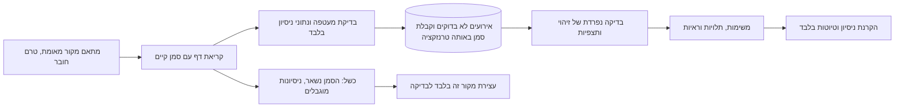

# קליטה מדורגת ונקודות המשך

מצב מקומי: PASS. מצב חיבורי המקור והעובד הפרוס: BLOCKED. הרכיב החדש נמצא ב־`src/services/business-ops/ingestion.js`; הוא אינו מופעל בשרת, אינו קורא חשבונות אמיתיים ואינו שולח הודעות.

נוספה קליטה של דף אירועים מנורמל אל מסד SQLite הקיים. האירועים, קבלת הדף והסמן הבא נשמרים באותה טרנזקציה. אם אירוע אחד בדף אינו תקין, כל הדף מתבטל והסמן נשאר במקומו. טרנזקציות האירועים הקיימות משתמשות ב־savepoints בתוך טרנזקציית הדף. הקוד נשאר סינכרוני בתוך הטרנזקציה; קריאת המקור מתבצעת לפניה.



## חוזה פנימי למתאם

זהו חוזה פנימי מוצע, ולא טענה לתמיכה ישירה ב־API של Gmail, Blueticks, Transkriptor או ספק אחר. המתאם צריך לספק `mode: 'synthetic'` ו־`readPage({cursor, limit, accountId, signal})`. אין כאן SDK של ספק או פעולת שליחה. `signal` מאפשר ביטול קריאה שאינה מסתיימת; מגבלת ברירת המחדל היא חמש שניות.

תוצאת קריאה היא `{id, events, nextCursor}`. אין להעביר אליה כותרות HTTP, אסימונים, אובייקטי הרשאה או פלט ספק גולמי. כל אירוע מכיל רק `id`, `source`, `scope`, `occurredAt`, `url`, `text` ומזהי לקוח/תיק/אדם או פרטי זיהוי מותרים. שדות אחרים נדחים. התוכן אינו יכול להעניק סמכות בדיקה או ליצור החלטות בעצמו.

`nextCursor` הוא נקודת המשך עמידה של המידע שכבר התקבל, ולא בהכרח `nextPageToken` של ספק. דף שאינו ריק חייב לקדם אותה. יש לאמת לכל ספק אם הסמן הוא watermark, מזהה היסטוריה או טוקן עמוד, ומה קורה בעמוד האחרון. אין כרגע מימוש או טענה לחוזה של ספק מסוים.

מזהה הדף חייב להישאר קבוע בניסיון חוזר של אותו תוכן. חזרה עם תוכן אחר נדחית. קבלת דף שכבר נשמר מחזירה את הקבלה המקורית בלי להחזיר את הסמן אחורה. מזהי אירועים מקבלים מרחב שמות לפי חשבון, כדי ששני חשבונות עם אותו מזהה הודעה לא יתנגשו. באירוע בר שינוי, כגון קובץ Drive או פגישת יומן, המתאם העתידי חייב לכלול במזהה גם גרסת מקור יציבה; שינוי אינו דריסה של ההיסטוריה.

כרגע מזהי הזרם, החשבון, האירוע והישויות המפורשות חייבים להיות מזהי TEST. טלפונים מוגבלים לטווח הניסיון של הפרויקט ומיילים ל־`example.invalid`. זו הגנה מפני חיבור שגוי, ואינה מנגנון לזיהוי מידע אמיתי בתוך טקסט. רק fixtures סינתטיים נמסרים למתאם. אין להסיר את ההגנות כדי להפעיל קליטת אמת ללא סקירה נפרדת.

## תור, כשל וחידוש

- lease מונע משני קוראים לטפל באותו מקור יחד. קורא שהתעכב מעבר לתוקף אינו רשאי לדרוס או לסמן כשל עבור lease חדש.
- קריאה כושלת מקבלת השהיה של שנייה ואז שתי שניות. לאחר שלושה כשלים המקור נחסם. דף לא תקין נחסם מיד לבדיקה. אין לולאת ניסיונות או סריקה אוטומטית ברקע.
- `resume` מחייב שחקן וסיבת התאוששות, שייכתבו ביומן. יש להפעילו מתוך כלי תפעול מאומת בלבד; לא מתוך הודעה נכנסת או פלט מודל.
- `runSourceRound` מעבד עד עשרה מקורות נפרדים. כשל או timeout של מקור אחד אינו מונע קבלה ממקור אחר.
- דוח הבריאות מבדיל בין מקור שמעולם לא התחבר, מקור תקין, מקור שלא התקבל ממנו דף בזמן ומקור חסום. הוא אינו מחזיר סמן או lease. מצב בריאות מקומי אינו הוכחת הרשאת קריאה של ספק.
- סמנים נשמרים בתוך SQLite לצורך חידוש. לפני פריסה נדרשים volume מוגן, גיבוי עקבי והרשאות לתפקידים; אין לחשוף את המסד או את הממשק לרשת ציבורית.

## בדיקות והרצה

```powershell
npm run test:business-ops
node tests/business-ops/ingestion-mutation-check.js
node scripts/business-ops-source-demo.js
```

המסע המקומי מעביר שלושה דפים: תמלול, מייל ו־WhatsApp. לכל דף קבלת קליטה, ולאחריה תצפיות מובנות שנבדקו במפורש ב־fixture. נותרות שתי משימות: איסוף מסמכים שהושלם עם שתי ראיות, ופנייה לבנקאי שנפתחה לביצוע. אין כאן חילוץ אוטומטי באמצעות מודל או שליחה לבנקאי. Drive, Calendar ו־manual רשומים אך מסומנים ככאלה שמעולם לא התחברו בניסוי.

תוצר הניסוי: `tests/out/business-ops-overnight-20261027/source-demo.json`. הוא מוחרג מ־Git. שתי מוטציות מכוונות בזיכרון מוכיחות שבדיקות הביקורת מזהות הסרת אטומיות של דף והסרת מרחב השמות של החשבון. קובצי המקור אינם משתנים בבדיקת המוטציות.

## מה עדיין מונע הפעלה

נדרשים חיבורי קריאה מאומתים וחוזי נתונים לכל מקור, סינון תיקים עסקיים מאושר, שירות פרטי נגיש מ־n8n, הרשאות לפי תיק, זהויות People נפרדות ליורם ולנריה, ומודל הצעות עם תקציב ומבחני דיוק. אין לחבר מודל לאסימון הבודק. מתזמן ייצור וקליטת אירועים אמיתיים לא הופעלו. טיוטת n8n הקיימת נשארה כבויה, ונתיבי LP1 ושרשרת הקליטה ללקוחות לא השתנו.
