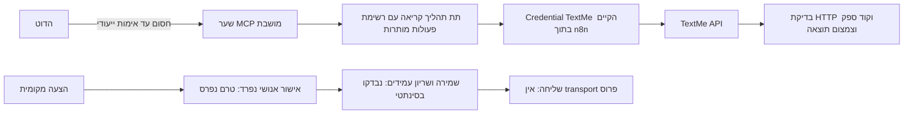

# TextMe אל הדוט דרך n8n: דוח המשך 28.10.2026

מצב כולל: BLOCKED לחיבור API מתוך הדוט ולהפעלה מלאה. קריאת API מתוך n8n אומתה בפועל. לא נשלחה הודעה ולא הופעל קמפיין.

| דרישה | מצב | ראיה |
|---|---|---|
| שימוש בתשתית ובחיבור הקיימים | PASS | Credential קיים TextMe API; תהליך UyusbbjI1hgkZ76k יוצא לגיבוי ולא שונה |
| אימות קריאת יתרה | PASS | תהליך 24CuXS88ao2olgfd, הרצה 62442, POST https://my.textme.co.il/api, HTTP 200, status 0, שדה יתרה תקין |
| קריאה דרך תת התהליך המוגבל | PASS | תהליך 3K6A1ipS8Qt04WVD, הרצה 62548; getVerifiedPhones החזיר HTTP 200 ו־status 0, שולח מאומת אחד |
| דחיית כתיבה לפני פנייה לספק | PASS | הרצה סינתטית 62547 נעצרה בצומת Validate read operation עם OPERATION_NOT_ALLOWED; צומת HTTP לא הורץ |
| בדיקת שרשרת הקריאה | PASS | תהליך Is1XtE3b6cHSiHN2, הרצת אב 62546; דחייה צפויה ולאחריה קריאת ספק; אפס הודעות שנשלחו |
| מקור ובדיקות מדיניות TextMe | PASS | 36 בדיקות מקומיות, exit 0; פירוט בראיות וב־tests/textme-dot/policy.test.js |
| בניית הפרויקט | PASS | node src/deploy/package.js, exit 0 |
| בדיקות הפרויקט | PASS | business ops: 32; funnel: 386; site: 60/60; deploy: 5. כל קבוצה עברה בפועל |
| שער MCP במצב בטוח | PASS | iKMn0xVxqoBqrBxK: active false, צומת מושבת, Bearer Auth, ללא Credential ביצוא חוזר |
| API מאומת מתוך הדוט | BLOCKED | אין Credential ייעודי למתקשר בשער MCP; לא נרשם listener, לא פורסם endpoint ולא נוספה כתובת MCP לתוסף |
| דוחות מסירה, נכנסות והסרות מול הספק | NOT TESTED | בניית בקשות והגנות נבדקו מקומית; לא נקרא תוכן הודעות לקוחות בהרצה זו |
| אישור ושליחה מבוקרת בייצור | BLOCKED | ספריית בקרה מקומית בלבד; אין מסלול אישור אנושי פרוס, חיבור למאגר הבקרה הקיים או transport לשליחה |
| ניהול ושינוי רשימות וקמפיינים | NOT TESTED | אין כלי כתיבה חשוף; מתאמי שינוי ייעודיים עדיין אינם ממומשים. לא הופעל קמפיין |
| תוסף הדוט הקיים | PASS | אותה זהות ואותו קהל פרטי נשמרו; עודכן ל־0.1.1, release pluginrel_6ae26d7702dc8191870e243a93883a05; אין בו כלי MCP או שליחה |

תגובות הספק המלאות נשארו במערכת המורשית. בראיות שבמאגר נשמרו HTTP Status, קוד ספק, נוכחות שדות, ספירה ומזהי הרצות; ללא יתרה כספית מפורטת, טוקן או רשימת מספרים.

## זרימה וסמכויות

אין מתג שליחה שנגיש לדוט. אישור עתידי חייב להיקשר לנמען אחד, מקור, נוסח, עלות ותוקף מדויקים. תוצאה עמומה אינה מאפשרת ניסיון נוסף. קבלת בקשה אינה מסירה. אישור המגיע בטקסט הודעה או בפלט מודל אינו זהות מאומתת של יורם.

## החסם והפעולה הבאה

הפעולה שלא ניתנת להשלמה כעת היא התחברות API מאומתת של הדוט לשער החדש. הסביבה היא n8n והלקוח הוא תוסף הדוט הפרטי. שדה Credential for Bearer Auth ריק; אין כאן שגיאת ספק או טוקן TextMe חסר. לא נעשה ניסיון ללא אימות ולא הומצאה תוצאת 401.

נדרשת השלמה של Credential כניסה ייעודי במסך Credentials המאובטח של n8n ושיוכו לטיוטה iKMn0xVxqoBqrBxK. אין למסור סוד בצ׳אט. לאחר אישור היקף הגישה: לפרסם את תת התהליך, לאפשר את השער המאומת, לבדוק דחיית גישה לא מאומתת ולבצע initialize, tools/list וקריאת יתרה דרך הדוט עצמו. רק לאחר אימות endpoint בפועל להוסיף אותו לתוסף עם API key מסוג bearer דרך מסך החיבור המאובטח.

להכנת שליחה מלאה נותר לחבר את ספריית הבקרה למאגר עמיד קיים אחרי בדיקת סכימה וגיבוי, לפרוס מסלול אישור אנושי נפרד, לאמת מחיר ומקור שולח, לחבר הסרות והסכמה, לבדוק שעות חשבון ולטפל בקבלות ובמסירה. לא נבחר שולח אוטומטית מהמספר הרשמי של Cosend. שינויי רשימות וקמפיינים ידרשו מתאמים מוגבלים ואישור מתאים לפני חשיפה.

## תקלות סביבת הבדיקות וטיפול

הרצת npm test הראשונה נכשלה בחיבורי localhost עם EACCES. בהרצה מורשית עברו business ops, funnel ו־site; deploy נכשל כי nginx לא היה מותקן. הורד nginx/Windows 1.30.6 מהאתר הרשמי לתיקיית בדיקה זמנית בלבד והורץ test:deploy עם NGINX_BINARY; חמש הבדיקות עברו. לא הותקן שירות ולא השתנתה פריסת ייצור. הלוגים הראשוניים נשמרו לצד ההרצות המוצלחות כדי לא להסתיר כשלים.

ב־n8n יבוא מוסיף צמתים ובוחר לעיתים Credential אוטומטית. נוצרה טיוטה נקייה; שער המקור הניסיוני r1nCwSHsi6CX45ix הועבר לארכיון הפיך. בטיוטה הקנונית אומת Bearer Auth ללא Credential. מחיקת צמתים גורפת נדחתה בבדיקת האישור האוטומטית; לא נעשה ניסיון לעקוף אותה. נבחרה החלופה הבטוחה של טיוטה נקייה וארכוב הפיך של הניסוי בלבד.

## שחזור ותחזוקה

כל התהליכים החדשים אינם מפורסמים. לחזרה: להשאיר או להחזיר את השער למושבת ולא מפורסם, בלי לגעת בתהליכי SMS המקוריים, Cosend, Blueticks או LP1. גיבוי היצוא המקורי נמצא מקומית ב־Downloads; גרסאות נקיות וראיות נשמרו תחת src/integrations/textme-dot/exports ו־docs/evidence/20261028-textme-api. לא נשמר ב־Git נתיב Webhook פרטי.

בעת הפעלה עתידית יש לאמת מחדש הגבלת IP בלי לפגוע במתקשרים קיימים, מדיניות שמירה, גיבוי ושחזור, זהות האדם המאשר, מחיר, הסכמה, מצב הסרה, חלון שליחה ורשומת מסירה. פרטי התפעול ובניית הטיוטות נמצאים ב־src/integrations/textme-dot/README.md.
