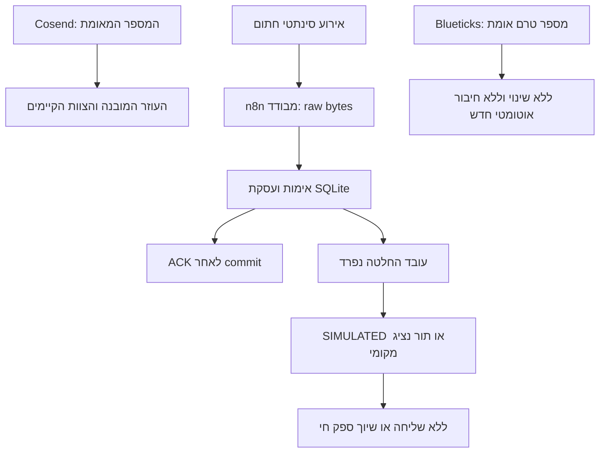

# WhatsApp ו־n8n: דוח המשך 28.10.2026

מצב הפרויקט החי: BLOCKED. גרסה 0.2.0-isolated.20261028 נבדקה ונפרסה בסביבה סינתטית מבודדת. לא נשלחו הודעות, לא בוצעו קריאות מודל אמיתיות, לא נרשמו אירועי לקוחות ולא שונה המשיב הפעיל.

## מקור וגרסה

חבילת המסירה נקראה מתוך Downloads/excelent-wa-draft-20261028.zip וחולצה לתיקייה חדשה. SHA256 המקור: `8a40a936083014670d832640f69d8677111e9d59417c00d881730be8360bbb37`. כל 21 הקבצים התאימו לאורך ול־hash במניפסט. תחילה נקראו README.md ו־manifest.json. המקור לא נכתב מחדש. הסוכן המבצע קיבל את ההנחיה המלאה ואת נתיב החבילה, וביצע שינויים בעותק נפרד בלבד.

המקור הועתק תחילה אל `src/services/wa-assistant/`. בהמשך נמצאו באותה תיקייה שינויים מקבילים שלא ביצע הסוכן המבצע: קובצי שליטת ספק, עובד מודל, מיגרציה ותצורת provider, וגם שינויים בקבצי המקור הקיימים. AGENTS.md עודכן במקביל והגדיר את config/provider.json כחיבור הקנוני. השינויים האלה נשמרו ללא דריסה ולא צורפו כעבודה שנבדקה כאן.

לכן מסירת הקוד ב־commit זה היא חבילת מקור קפואה בלבד: `docs/evidence/20261028-wa-assistant/verified-source.zip`, גרסה 0.2.0-isolated.20261028, 31 קבצים, SHA256 `3503c5b73f4a91d639ac18d60a8be02d8ebeb300c069034af2f21d9f98152de5`. היא אומתה שוב בתיקייה נפרדת: 63/63. היא ראיה היסטורית ומקור להשוואה, ולא מחליפה את תיקיית המקור הקנונית המתפתחת. אין להחיל אוטומטית את תוצאות הבדיקות האלה על הגרסה המקבילה.

יצוא הטיוטות בחבילה כולל השחרת נתיב Webhook; הוא אינו העתק בתים מלא לצורך שחזור. היצוא המקורי והגיבויים המוגבלים נשמרו בשרת מחוץ ל־Git. לא נדרסו השינויים המקומיים הקיימים במאגר.

## סטטוס וראיות

| דרישה | מצב | ראיה והיקף |
|---|---|---|
| אימות החבילה | PASS | 21 קבצים תואמים; מניפסט המקור שמור לצד הקוד |
| בדיקות המקור המעודכן | PASS | npm test: 63/63 במחשב וב־VPS; exit 0 |
| בקרות שליליות | PASS | 8 מוטציות בקוד פגום זוהו, כל אחת נכשלה ב־exit 1 כמצופה |
| בניית תהליכים | PASS | npm run build:workflows: שלושה JSON לא פעילים; exit 0; נתיב placeholder |
| בדיקות מדיניות בשרת n8n הקיים | PASS | הרצה 59677, תהליך 0nesgH42OpyQdncL, 24/24; קוד מדיניות SHA256 לאחר הסרת export: 1de6b37196a4532dddff7c4fff5ebedd7eebfadb89bd10da710262436a147f39 |
| HTTP, כשל אחסון וקריסה | PASS | service-smoke: 16/16; HTTP אמיתי ותהליך Node אמיתי, ספק ומודל מדומים בלבד |
| שירות הדמה הראשון ואתחול Docker | PASS | 12 בדיקות HTTP מול שירות v1 ב־VPS לפני ואחרי restart; SQLite נשמר, כפילות נמנעה והעברה לנציג עצרה תשובה נוספת |
| בריאות שירות v2 לאחר החלפת המקור | PASS | health החזיר 200 ו־ISOLATED_NO_SEND; לפני החלפה אומתה זהות בתים של broker.mjs ו־server.mjs מול v1 |
| מסלול מלא נוסף לאחר פריסת v2 | BLOCKED | הבדיקה הסופית נעצרה לאחר ניתוק המסוף; אין להסיק מ־health בלבד שכל המסלול נבדק שוב ב־v2 |
| העברת raw bytes דרך n8n | PASS | מופע n8n סינתטי נפרד ללא רשת; 10 בדיקות, 6 הרצות עם סטטוסים סופיים. הדוח המלא נשאר בשרת; תצפית מסוף מתועדת ב־docs/evidence/20261028-wa-assistant/observations.json |
| גיבוי ושחזור מאגר 8788 | PASS | SQLite backup API ולא העתקת DB ללא WAL; שחזור לקובץ פרטי נפרד ו־integrity_check=ok; הייצור לא שוחזר ולא שונה |
| מניעת שליחה בסביבת הבדיקה | PASS | network=none, ללא ports, ללא מנוי ספק, ללא Credential ספק או מודל, אין נתיב HTTP לשליחת לקוחות |
| חיבור חי, נעילת ספק והעברה לתיבת נציג | BLOCKED | החיבור שמותקן ב־n8n מוגבל ל־connections:read; אין מימוש מחובר ומאומת של preflight/נעילת ספק/הקצאה לתיבה |
| מודל אמיתי ותקציב | BLOCKED | לא נמצא Credential או צומת מודל ב־n8n שנבדק; אין אישור למודל ותקציב API עבור העובד החדש |
| בעלות יחידה על המענה | BLOCKED | Cosend AI receptionist פעיל; מספר Blueticks והודעות/קמפיינים מתוזמנים שלו טרם אומתו |
| ניטור והתראות מול ספק חי | BLOCKED | ops-status הוא צילום DB בקריאה בלבד; יעד התראה, הרשאות, ניתוק, מכסות וכשלי חתימה מתמשכים טרם חוברו ואומתו |
| מדיניות נתוני אמת | BLOCKED | דרושים אישור שמירה/מחיקה, הצפנה וגיבויים ותוכנית שילוב באותו שירות ומאגר 8788 |
| פיילוט, מסירת WhatsApp ומודל אמיתי | BLOCKED | דרושים החיבורים, תוכנית מעבר ואישור נקודתי; לא בוצעו ולא נטענה הצלחה |
| בניית תמונת Docker מה־Dockerfile המצורף | NOT TESTED | נעשה שימוש בתמונה קיימת ונעולה לפי digest; אין טענה שה־Dockerfile עם node:24 נבנה בשרת |
| פרסום ובדיקת תיקיית המקור הקנונית הנוכחית | BLOCKED | נדרשת התאמה עם השינויים המקבילים באותה תיקייה; commit זה כולל רק דוח, ראיות וחבילה קפואה ללא שינוי AGENTS.md או מקור משותף |

24 בדיקות המדיניות הן תת־קבוצה של הסוויטה המקומית. אין לחבר את המספרים כאילו היו בדיקות עצמאיות או ראיות ספק.

## מיפוי שנקרא בפועל

Cosend: מרחב `org_01M5WPXWKXTYNDCHAJ6YTMWZ5Z`, חיבור `conn_01M5YC386Q2N9973TJG1M8H4DQ`, מספר `+972559881245`, WABA `848287037598986`, מזהה מספר Meta `1138723472651617`. אלה נבדקו מחדש בממשק. לא נעשה שימוש במזהה הישן לצורך חיבור או שליחה.

המספר במצב stored/coexistence. העוזר המובנה On והציג 2 מענים ו־1 העברה היום. האוטומציה המותאמת למענה ראשוני ושעות פעילות Off. רשימת Webhooks v1 הציגה No endpoints yet. לא הסתמכנו רק על כתובת Raw Relay ריקה. הוצגה מגבלת WhatsApp בנוגע לאישור שם התצוגה; לא שינינו שם, זהות או מגבלה.

מפתח n8n הקיים נבדק בממשק: connections:read בלבד. קיים גם מפתח אחר בשם גרוק עם הרשאות רחבות, אך ערכו אינו נגיש דרך ה־Credential המאושר של n8n; הוא לא הועתק, לא הורחב ולא נעשה בו שימוש. קיום המפתח אינו הרשאת שליחה לעובד החדש.

בתיבת Cosend נמצא רק יורם פלד, office@kho.org.il, Owner Active, במנוי Free עם 1/1 מושבים. נריה לא נמצא כחבר בתיבה. לא בוצעה הזמנה או רכישה. אפשר להכין העברה ליורם; הוספת נציג אחר דורשת בירור זכאות ועלות ואישור נפרד.

Blueticks: בממשק WhatsApp הקיים נצפה מצב בוטים לא פעילים. המספר, רשימת הסוכנים וההודעות המתוזמנות אינם מאומתים. לא נפתח צ'אט חדש, לא סומנו הודעות כנקראות ולא שונו הגדרות, קמפיינים או חיבורים. אין בסיס לקבוע שזה אותו מספר.

בשרת נמצא `excelent-wa-intake` פעיל, Node v26.7.0, מקור `/docker/excelent-wa-intake-20261022/app`, מאגר `/docker/excelent-wa-intake-20261022/data/excelent-wa-intake.sqlite`. הטבלאות הן wa_candidate_events ו־wa_candidate_scans. הקוד נבדק: זהו תור CRM עם תפיסה, reconciliation ו־readback, ללא מנגנון שיחות/תיבת יציאה של העוזר. נשמר מסמך MIGRATION.md להרחבה באותו מאגר; לא נוספה קליטה חיה למאגר מקביל.

שלוש הטיוטות 0nesgH42OpyQdncL, 90jZAb9ZFDOnEQ0e, wyMfdiAAyfhtDyrP נמצאו inactive וללא Credentials. הן לא יובאו שוב לשרת הייצור. בדיקת הקריאה AwCquhPHa4OgjkEo נשמרה. HNvsmdIDsvrHkZuw נמצא active.

נמצא פער במסירה: QEGe2prEvnA4i47J הוא תהליך המענה המיידי של משפך המחזור. הצמתים כוללים Instant reply, Has send?, Live?, Send WhatsApp ו־Update item (instant). הוא לא סווג מחדש כעובד CRM ולא שונה. העובד האמיתי הוא StS89G1uHOBX2znO, בשם Excellent WA CRM worker NO MESSAGES. הוא Published ומכיל Claim pending event, Create once with owner, Independent item read ו־Reconcile existing event. המזהה אומת בהמשך מתוך כתובת התהליך והממשק, בלי להריץ או לערוך אותו. ראיה נוספת: docs/evidence/20261028-wa-assistant/crm-worker-readback.json. התצפית הקודמת שהשאירה את המזהה לא ידוע נשמרה כהיסטוריה.

## השינויים בקוד

הסעיף מתאר את החבילה הקפואה שנבדקה, ולא מאשר שינויים שנוספו במקביל בתיקיית המקור הקנונית.

העברה לנציג תופסת שליטה אנושית עמידה, מבטלת תשובות ממתינות ומונעת תשובה אוטומטית להודעה הבאה. אין הודעת אישור שמבטיחה שהנציג ראה את הפנייה. שחרור שליטת אדם אינו אוטומטי.

dispatch עתידי מחייב callback מפורש ל־preflight; callback חסר, תשובה שאינה true או חריגה חוסמים את השליחה. ה־HTTP server אינו מייבא מתאם לשליחה ואין בו נתיב המאפשר שליחה ללקוחות. ה־callback המקומי אינו הוכחה לנעילת ספק חיה.

תוקנו דיווח SIMULATED על פריט חסר/מבוטל, echo היסטורי שתפס שליטה, ו־health שהצליח על סכמה שבורה. נוסף מעקב סטטוסים עמיד עם הפרדה בין ACCEPTED לבין delivered/read/failed וללא נסיגה מסטטוס מסירה חזק. תגובת 2xx עמומה מסווגת UNCERTAIN וחוסמת המשך שליחה עד בירור. קבלה 201 בלבד אינה ראיית מסירה.

## פריסה, בדיקות וחזרה

השירות המבודד הוא `excelent-wa-isolated-20261028-v2`, גרסה `0.2.0-isolated.20261028`, בתמונה הקיימת:
`sha256:ffeb52485f78b1b06c9a832205853cf75da72a07a514c9a27724df85979d6c34`.

אין רשת, אין פורט למארח, traefik.enable=false, מערכת קבצים לקריאה בלבד, uid 1000, ללא capabilities, no-new-privileges, מגבלות זיכרון/CPU/תהליכים ובדיקת health. המפתחות המותקנים בו סינתטיים בלבד. אחסון סינתטי עמיד נשמר תחת `/docker/excelent-wa-isolated-20261028/state`. הוא אינו מחובר למקור לקוחות.

פריסת v2 החזירה מזהה קונטיינר עם קידומת `4ff7cbb95c48`. health לאחר ההפעלה עבר. טרם נאספה מחדש ראיית מצב Docker healthy או בדיקת קליטה מלאה של v2. אימות אלה נחסם בניתוק המסוף ובכשל בחיבור חלון חדש. לא בוצע ניסיון לעקוף אישור מחשב שלא התקבל.

ה־HEAD האחרון שנקרא בשרת וב־origin לפני השמירה היה `5305b5365dfffa547735b5b53f560f56753c3f89`. הקוד הסינתטי נפרס מעותק עבודה נפרד תחת /docker/excelent-wa-release-20261028, לפני יצירת commit הפרסום. אין כאן טענה ש־HEAD של שרת הנחיתה התקדם בעקבות שמירת הקוד ב־GitHub; פריסת הנחיתה לא שונתה.

פקודות הפריסה נשמרו לפני הביצוע תחת אותו נתיב. הגיבוי הפרטי למערכת הקיימת הוא `/docker/excelent-wa-backups/20261028-preflight`; נבדק שחזור לקובץ נפרד. חזרה מהגרסה הסינתטית: `/docker/excelent-wa-isolated-20261028/rollback-v2.sh`, שעוצר את v2 ומפעיל את הקונטיינר הקודם תוך שמירת המאגר. אין למחוק רשומות הסרה, dedup או תוצאות שליחה עמומות בזמן חזרה. אין שינוי Nginx במסגרת עבודה זו.

הניסיון הראשון להעלות את שירות הדמה נכשל: ZIP שנוצר ב־Windows כלל backslash בשמות קבצים ולכן Node לא מצא /app/src/server.mjs. תוקן מנגנון החילוץ עם נרמול ובדיקת גבולות נתיב. לאחר מכן הבדיקות עברו. לא הייתה פגיעה בתהליכי הייצור.

בבדיקת n8n המבודדת הראשונה עברו בדיקות HTTP אך נשמרו סטטוסים running. לא נטען שההרצות הסתיימו בהצלחה. הבדיקה חזרה פעם אחת עם שמירת success/error=all והמתנה מוגבלת לסטטוסים סופיים, במופע הסינתטי בלבד. שמירת האירועים בשרת n8n הקיים לא שונתה.

בבדיקה החוזרת עברו 10 בדיקות. מזהי 1–5 הסתיימו ב־success ומזהה 6 ב־error כמצופה אחרי ניתוק broker. אלה מזהים של DB סינתטי חדש, אינם מזהים משרת n8n החי ואינם ראיית ספק. הדוחות המלאים שנוצרו בפועל נשמרו בשרת תחת n8n-synthetic-output/n8n-raw-result.json ו־n8n-synthetic-output-v2/n8n-raw-result.json. הם לא הועתקו למחשב עקב אובדן הגישה למסוף. observations.json הוא תיעוד תצפיות, אינו מוצג כיצוא מקורי של הדוחות האלה.

| כתובת בקשה סינתטית | HTTP | גוף/ראיה |
|---|---|---|
| http://127.0.0.1:8789/health | 200 | ok=true, mode=ISOLATED_NO_SEND |
| http://127.0.0.1:8789/ingest, חתימה תקינה | 202 | code=durably_stored ובדיקת רשומה ב־SQLite |
| אותו אירוע פעם נוספת, גם אחרי restart | 200 | code=duplicate_event; מספר הרשומות אינו גדל |
| אותו endpoint עם חתימה שגויה | 401 | code=invalid_signature; אין שמירה |
| /ingest תחת כשל כתיבה סינתטי | 503 | code=durable_storage_or_processing_failure; ללא ACK הצלחה |
| /send בשירות המבודד | 404 | code=not_found; אין נתיב שליחה |

## מפת אחריות ותהליך

## חבילת מעבר שטרם אושרה

המספר המועמד לפיילוט הוא +972559881245, ללא שינוי זהות או ניתוק ספק. שלוש הטיוטות נשארות כבויות. לפני הפעלה נדרשת החלטה מפורשת מי עונה במקום העוזר המובנה, אימות מנגנוני האפליקציה/Blueticks, וראיית נעילה/שליטה ונציג בתיבת הספק. אין להפעיל שני משיבים.

דרוש חיבור מאושר ומוגבל לחיבור היחיד לקריאת שיחה/הסרות/סטטוסים, נעילה והעברה, ורק לאחר אישור גם שליחה ורישום Webhook. התקנת סודות תבוצע במסך/מאגר המאובטח; אין למסור מפתחות בצ'אט. נדרש מודל מזוהה, סוג מידע שנשלח, תקציב ותקרה. מנוי ChatGPT ומכסת העוזר המובנה אינם אישור ל־API חדש.

הפיילוט לא נקבע כפעיל. לפני בדיקת מסירה יש להציג למאשר מספר בדיקה בבעלותו, נוסח מדויק, מספר הודעות ועלות אפשרית, ולקבל אישור נקודתי. לאחר מכן יש להוכיח קבלה/מסירה או העברה בתיבת הספק, פעילות נציג במרוץ לפני שליחה, הסרה, שגיאה עמומה והתאוששות. הרחבה מותנית בהיעדר כפילויות ובהעברה לנציג שעובדת בפועל.

נוסח וזמינות העוזר נבדקו עם נתונים סינתטיים: אקסלנט בניהול יורם פלד, א-ה 08:15–20:00 Asia/Jerusalem, הצגה כעוזר דיגיטלי ואפשרות לנציג. Calendly ו־BizReviews נפתחו מחדש והציגו עמוד עסק מתאים. לא נקבעה פגישה ולא נלקחו מהאתר דירוג, מחיר או הבטחה לצורך מענה. הוראות WhatsApp לקריאה וטיוטות נשארו בתוקף.

## מקורות ספק

תיעוד שנקרא מחדש: [Cosend Webhooks](https://cosend.app/docs/webhooks), [API reference](https://cosend.app/docs/reference), [Runtime API](https://cosend.app/docs/runtime-api), [n8n Server CLI](https://docs.n8n.io/hosting/cli-commands/). הבדיקה המבודדת השתמשה בחתימת אירועי v1 על t.raw_body; היא אינה אימות של חתימת Meta או Raw Relay.

## שמירה במאגר

הדוח, חבילת המקור הקפואה והראיות נשמרו ב־commit `960be1bff33b3c656934c020173df3b83dc5f08b`. הענף codex/lock-service-20261025 עודכן ללא force, עם בדיקת HEAD צפוי, ולאחר מכן נקרא מחדש מהשרת. גם קובץ ה־ZIP נקרא מחדש ונמצא תואם ל־blob שהועלה. ראיית הפרסום: docs/evidence/20261028-wa-assistant/publication-960be1.json. אין כאן איפוס של ה־checkout המקומי או הכללה של שינויים מקבילים במקור הקנוני. אימות מזהה עובד ה־CRM נוסף בהמשך כעדות נפרדת.

הפעולה הבאה בקוד: בעל העבודה על המקור הקנוני ישווה את החבילה הקפואה לשינויי provider/control/model/migration, יריץ בדיקות על גרסה משותפת מזוהה וישלים בדיקת מסלול לאחר פריסתה. אין להעתיק את החבילה על תיקיית המקור. בהמשך יש להשלים דרך בעל החשבון חיבור מצומצם, מודל/תקציב, בעלות מענה, מדיניות מידע ויעד נציג, ואז לעדכן את חבילת ההפעלה עם פרטי בדיקת המסירה המדויקים. לא הופעלה שליחה ולא מוצגת השלמה של הפרויקט החי.
